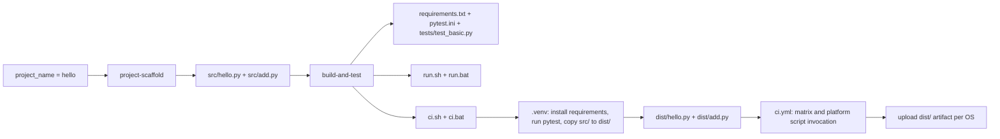

# Архітектура агента Build Engineer

## 1. Проблеми, які вирішує агент

Агент `build-engineer` автоматизує повторюване налаштування невеликого Python-проєкту: створення Hello World scaffold, віртуального середовища, команд запуску, юніт-тестів і кросплатформного CI. Він розділяє ці обов'язки на окремі skills та команди, перевіряє результат ідемпотентно та не перезаписує наявні файли з невідповідним вмістом. CI підтримує Windows, Linux і macOS.

Проєктні файли генеруються у гілці `feature`; у `develop` створюються лише конфігурація агента та документація.

## 2. Skills та їхні обов'язки

| Skill | Відповідальність |
| --- | --- |
| `project-scaffold` | Створити `src/hello.py` і `src/add.py`, підготувати каталоги `tests/` і `docs/`, додати README лише за його відсутності та перевірити запуск Hello World. |
| `build-and-test` | Налаштувати `requirements.txt`, `pytest.ini`, тест додавання, скрипти `run.sh`/`run.bat` і `ci.sh`/`ci.bat`; керувати venv та підготувати `dist/`. |
| `github-actions` | Створити workflow з матрицею Windows, Linux і macOS, який запускає відповідний CI-скрипт і завантажує `dist/`. |

## 3. Commands користувача

| Команда | Призначення |
| --- | --- |
| `/git-init` | Перевірити Git-репозиторій, створити або ідемпотентно доповнити `.gitignore`, показати статус. |
| `/create-project` | Створити Python Hello World scaffold через `project-scaffold`. |
| `/create-build` | Налаштувати залежності, venv-based скрипти запуску, pytest і CI-скрипти через `build-and-test`. |
| `/create-actions` | Створити та перевірити кросплатформний workflow через `github-actions`. |
| `/check` | У режимі лише читання перевірити інструкції, файли, тести, CI, Git та вивести таблицю PASS/FAIL. |
| `/init` | Послідовно оркеструвати попередні кроки й запустити фінальний `/check`. |

## 4. Передавання даних між етапами

`project-scaffold` отримує `language=Python` і `project_name=hello`; ім'я визначає назви модулів та вітальне повідомлення. `build-and-test` використовує наявні модулі з `src/`, додає залежність `pytest>=7`, конфігурацію тестів і скрипти. Скрипти самостійно керують `.venv`, встановлюють залежності й запускають тести; CI-скрипти після успішних тестів копіюють модулі до `dist/`. Workflow не запускає Python, pip чи pytest напряму: він обирає `ci.sh` для Linux/macOS або `ci.bat` для Windows і завантажує артефакт `dist/`.

## 5. Обробка помилок в `init`

`init` читає та виконує п'ять prompt-файлів строго по одному: `git-init` → `create-project` → `create-build` → `create-actions` → `check`. Після кожного кроку перевіряє його результат; наступний крок запускається лише після успіху попереднього. При першій помилці оркестратор зупиняється, вказує крок, причину та що потрібно виправити, позначає попередні кроки `PASS`, помилковий `FAIL`, а невиконані `SKIPPED`. Загальний статус може бути `PASSED` лише після явного `PASSED` від фінального `check`.

## 6. Відповідність файлів ролям

| Роль | Розташування | Файли |
| --- | --- | --- |
| Agent | `.github/agents/` | `build-engineer.agent.md` визначає роль, інструменти, обмеження та порядок роботи. |
| Skills | `.github/skills/` | `project-scaffold/SKILL.md`, `build-and-test/SKILL.md`, `github-actions/SKILL.md` описують спеціалізовані процедури. |
| Commands | `.github/prompts/` | `git-init.prompt.md`, `create-project.prompt.md`, `create-build.prompt.md`, `create-actions.prompt.md`, `check.prompt.md`, `init.prompt.md` задають команди користувача. |

## 7. Формат VS Code Copilot

Для реалізації використано формат кастомізацій VS Code Copilot: custom agent (`.agent.md`), prompt files (`.prompt.md`) і agent skills (`SKILL.md`). Frontmatter агента задає його опис та інструменти, prompt-команди пов'язують дії з агентом `build-engineer`, а skills надають спеціалізовані інструкції для окремих етапів.